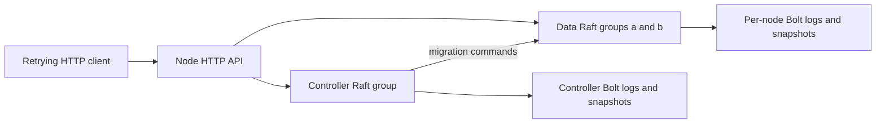
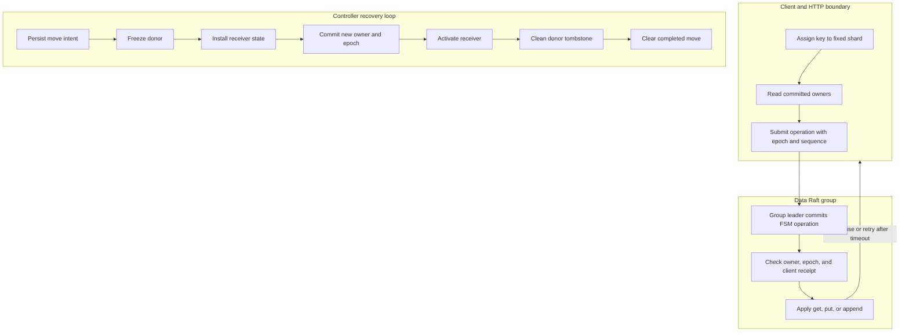

# Sharded Raft key/value database

## Contents

- [Architecture and execution guide](#architecture-and-execution-guide)
- [Run verification](#run-verification)
- [Run a persistent cluster](#run-a-persistent-cluster)
- [HTTP reference](#http-reference)
- [Bounds and limitations](#bounds-and-limitations)

The [hosted native k6 measurement](docs/benchmarks/2026-10-22-k6-v2.md) completed a 100 transactions/s, 120-second run: all 12,001 native starts finished (12,000 requested plus one framework boundary offer), with zero dropped or failed logical transactions. Started transaction-group p50/p95/p99 was 1.934 / 3.509 / 4.687 ms. At 1,024 bytes, 95% reads and eight VUs, five-repeat p99 had median 5.269 ms (range 3.912–7.369). Six one-VU matrix trials retained 11 drops; both migration and leader-loss journeys passed exact readbacks. Four visible EPYC 9V45 cores, Go 1.27.3 and k6 2.3.0; this fixed offered workload does not establish maximum throughput or intended-arrival latency.

The [version-2 driver](docs/benchmarks/k6-v2-plan.md) is reproducible with `python tools/benchmark.py benchmark` on isolated Linux; `smoke` owns the nine-node cluster and checks exact committed values. Source, environment, full medians/ranges, raw hashes, negative cells and resource limits accompany the results. Earlier invalid fixtures and failed raw verdicts remain preserved. Native hot-path CPU profiling and replication-index telemetry remain unmeasured; shard count remains fixed at four.

A bounded teaching database with two data groups and a replicated configuration controller. Each group runs three independent processes. Every node has its own TCP Raft transport, durable Bolt log, stable state, and file snapshots. New code lives in `sharddb` and `cmd/sharded`.

This is an independently implemented, course-inspired project. It contains no MIT lab skeleton, grader, or student solution. It does not claim MIT assignment completion. The design follows the mechanisms described in the [2026 sharded-service requirements](https://pdos.csail.mit.edu/6.824/labs/lab-shard1.html) and the [Raft paper](https://raft.github.io/raft.pdf). Exact MIT lab code remains subject to its [course publication policy](https://pdos.csail.mit.edu/6.824/general.html).

The complete [hraftd source](https://github.com/otoolep/hraftd) and upstream Git history are preserved at revision `97a01648bd9e2dfc4c95c3c25a3621dd8d153adb`. Philip O'Toole's MIT license and original example API remain intact. [README.upstream](README.upstream) is the exact original README. HashiCorp Raft provides consensus rather than a new consensus implementation. Dependencies retain their own licenses, including Raft's [MPL 2.0 license](https://github.com/hashicorp/raft/blob/v1.7.0/LICENSE).

## Run verification

Use Go 1.25 or newer and Python 3.11. The recorded Windows run uses Go 1.27.3. No Python packages, cloud service, container engine, or API key are required.

```powershell
go test ./...
go vet ./...
python -m unittest discover -s tools -p test_*.py
go build -o sharded.exe ./cmd/sharded
python tools/verify.py
```

The verifier starts nine actual processes on distinct loopback ports and stores each node in a separate directory. It prints the retained `evidence/journey-<run>` directory. `result.json` records the verdict. `history.json` records logical operation invocation and return times, inputs, results, client identities, epochs, and groups. `events.json` records owned PIDs, crashes, and assertions. Per-process logs show Raft elections, snapshots, and restore. Cleanup stops only the run's owned processes and retains the evidence and state.

Each journey begins with `passed: false` and finalizes its result only after cleanup. Failed journeys retain their error and process/proxy cleanup status, then preserve their nonzero exit. Run `python tools/verify.py --fail-after-doctor` to exercise the controlled failure path. It exits 1 after the nine nodes are ready and must retain a failed verdict with successful cleanup. CI checks that behavior. Historical evidence folders are never rewritten to add missing verdicts.

The project [verification skill](.agents/skills/verify-sharded-database/SKILL.md) and [feature map](.agents/skills/verify-sharded-database/features/README.md) describe the maintained driver. The baseline command is `go build -o baseline.exe .` followed by `python tools/verify.py --baseline`.

## Run a persistent cluster

Create a local JSON configuration with a random 24 to 128 byte `Token` and nine `Nodes`. Each node needs `ID`, `Group`, `HTTP`, `Raft`, and `Dir`. Groups are exactly `controller`, `a`, and `b`, with three members each. All addresses must be numeric loopback addresses. All node IDs, ports, and storage directories must differ. The verifier's generated `cluster.json` is a concrete working example. Keep this administrative capability file private.

For each node, start a separate terminal with its ID and the same configuration file. For example, to resume a verifier-created controller after the verifier exits:

```powershell
.\sharded.exe -config evidence\journey-<run>\cluster.json -node controller0
```

Start the remaining eight IDs from that file. Restart each node with the same file and directory to recover its durable state. Do not change membership or addresses in an existing cluster. Empty directories bootstrap the fixed three-member groups. The original hraftd executable remains available through `go run .` and its original commands in README.upstream.

Use the retry client from Python. Operations for one client identity must be serialized. Preserve its sequence across reconnects; after an uncertain outcome, retry that exact identity and sequence before issuing another operation.

```python
import json
from tools.client import Client
config = json.load(open('cluster.json'))
client = Client(config, 'my-session')
client.op('put', 'hello', 'world')
client.op('append', 'hello', '!')
assert client.op('get', 'hello') == 'world!'
```

## Architecture and execution guide

This project adds `sharddb` and `cmd/sharded` to the preserved `hraftd` example. HashiCorp Raft provides consensus, TCP transport, Bolt-backed logs, and snapshots. The added state machine supplies four fixed shards, a three-node configuration-controller group, and two three-node data groups.

The boundary map shows the client, controller, data groups, and their independent Raft state.



Each process serves one HTTP endpoint and participates in one fixed Raft group. The controller stores shard ownership and migration progress. Data-group state machines apply key operations and migration commands. Client operations go to the group that owns the shard at the committed configuration epoch.

This flow follows a key operation and shows how the controller's persisted migration phases recover after a leader change.



The client retries bounded HTTP failures against known group members while preserving its sequence. A timed-out operation can have committed, so it remains uncertain until the same client identity and sequence is retried. During a move, the donor freezes before the receiver activates. The persisted phase record lets the controller leader resume; the shard can be temporarily unavailable during this handoff.

| Subsystem | Responsibility | Owned state or invariant | Source |
| --- | --- | --- | --- |
| Node lifecycle | Validate fixed membership and open Raft, storage, and HTTP | Nine nodes, three per group, distinct loopback addresses and directories | [`sharddb/node.go`](sharddb/node.go) |
| Data state machine | Apply key operations and migration actions | Four shards; owner epoch, values, per-client receipts, and freeze mode | [`sharddb/state.go`](sharddb/state.go) |
| HTTP service | Authenticate and route operations to the local leader | Bearer capability and bounded request slots | [`http/service.go`](http/service.go) |
| Controller mover | Persist and advance migration phases | One in-flight move and monotonic phase/epoch checks | [`sharddb/node.go`](sharddb/node.go) |
| Retry client | Refresh configuration and retry leaders | Stable client identity and increasing per-operation sequence | [`tools/client.py`](tools/client.py) |

Terms used in the operation and handoff paths: [Raft](#concept-raft), [state machine](#concept-state-machine), [shard](#concept-shard), [epoch](#concept-epoch), [fencing](#concept-fencing), [migration](#concept-migration), [idempotency](#concept-idempotency), and [linearizability](#concept-linearizability).

<a id="architecture"></a>

### Follow a key operation

1. Start each node with the same fixed configuration and its own persistent directory. An empty directory bootstraps that node's three-member Raft group.
2. The client maps the key to one of four shards and fetches committed owner information from the controller group.
3. The client sends the operation, epoch, identity, and sequence to a data-group member. A follower returns HTTP 409; the client tries another member.
4. The group leader commits the operation through Raft. Its FSM checks epoch and client receipt before changing values or returning a read.
5. The client records the result. After an uncertain timeout, it retries the same identity and sequence before issuing another operation.
6. For a move, the controller commits intent, freezes the donor, stages receiver state, publishes ownership, activates the receiver, and cleans the donor. A restarted controller resumes the recorded phase.

### Design decisions and limits

These rationales are inferred from the current implementation. They do not record historic design intent.

| Choice | Practical rationale | Alternative and cost | Reconsider when |
| --- | --- | --- | --- |
| Use HashiCorp Raft as the consensus library | The extension needs sharding and recovery behavior while preserving the upstream example | Implementing Raft locally adds another consensus implementation and safety surface | The exercise requires changing consensus internals |
| Keep three fixed groups and four shards | Small topology makes ownership and migration journeys explicit | Dynamic membership scales topology but needs reconfiguration and discovery | The deployment needs elastic groups or shard counts |
| Persist migration as numbered phases | A leader can resume work after restart and each step checks epoch | Atomic cross-group transactions need a coordinator protocol with broader coupling | Cross-shard atomicity becomes a requirement |
| Freeze before receiver activation | Prevents intentional concurrent service from both owners | Overlap improves availability but requires conflict resolution or fencing at every read/write | Temporary unavailability is unacceptable |
| Retain per-client sequence receipts | Retries suppress repeated effects for the latest sequence per shard | Time-based eviction saves space but can repeat old operations | Client counts exceed the explicit 64-ledger bound |

### Glossary

<a id="concept-raft"></a>

<details><summary>What is Raft?</summary>

Raft is a consensus protocol that orders log entries across a group. This project uses HashiCorp's implementation; a key write is applied by the group's committed state machine.
</details>

<a id="concept-state-machine"></a>

<details><summary>What is a state machine?</summary>

A state machine applies ordered commands to state and returns results. Here `sharddb.FSM` owns shard maps and accepts only commands with valid epochs.
</details>

<a id="concept-shard"></a>

<details><summary>What is a shard?</summary>

A shard is a partition of keys assigned to a data group. FNV-1a maps keys into four fixed shards; each shard records its current group and epoch.
</details>

<a id="concept-epoch"></a>

<details><summary>What is an epoch?</summary>

An epoch is the monotonically increasing ownership version for a shard. A request with an old epoch is rejected after a migration publishes a newer owner.
</details>

<a id="concept-fencing"></a>

<details><summary>What is fencing?</summary>

Fencing rejects commands from a stale owner or controller. The FSM checks shard epoch and mode before accepting a data or migration command.
</details>

<a id="concept-migration"></a>

<details><summary>What is shard migration?</summary>

Migration transfers shard values and client receipts between groups while changing the owner epoch. The controller records six phases, from intent through clearing the completed move.
</details>

<a id="concept-idempotency"></a>

<details><summary>What is idempotency?</summary>

Idempotency means retrying the same identified operation does not apply its effect twice. This implementation remembers the last sequence and fingerprint for each client on each shard, not an unlimited history.
</details>

<a id="concept-linearizability"></a>

<details><summary>What is linearizability?</summary>

Linearizability means each completed operation appears to take effect at one point between its call and response. Data operations here commit through their group Raft log; `/status` is diagnostic and is not a linearizable read.
</details>

## Architecture

FNV-1a assigns keys to four fixed shards. Initially, shards 0 and 2 belong to group `a`, and shards 1 and 3 belong to group `b`. Each shard has an epoch, an ownership mode, a key map, and a per-client receipt ledger. Get, Put, and Append all execute as committed Raft FSM operations. A follower's local map is never used for the new public Get. Configuration queries also commit through the controller Raft group.

The controller admits one migration at a time with a compare-and-set on the current owner and next epoch. It persists the intent before contacting either data group. Its leader resumes the following recorded phases after election or restart:

| Stored phase | Next action |
| --- | --- |
| 0, intent | Freeze the donor through its Raft log. |
| 1, frozen | Fetch the frozen donor state and commit a staged receiver install. |
| 2, installed | Publish the receiver and new epoch in the controller log. |
| 3, published | Activate the receiver through its Raft log. |
| 4, activated | Clean the frozen donor, preserving its epoch tombstone. |
| 5, cleaned | Clear the controller's completed migration record. |

Values and client receipts move together. Every data action and controller transition checks its epoch. Repeated actions converge without replaying a write. Delayed cleanup cannot delete a shard that has returned to its former group. The donor freezes before the receiver activates, so migration can temporarily make a shard unavailable but cannot intentionally serve it from both owners. Stale controllers cannot advance a newer migration through an older phase transition. These are sharding and recovery mechanisms layered on existing Raft, not changes to Raft's safety rules.

The client refreshes committed configuration and tries the fixed group members when a leader or epoch changes. Retries are bounded by a logical deadline, plus an in-flight HTTP timeout. A timeout represents an uncertain outcome. The receipt ledger suppresses duplicate effects for the last sequence of each client on each shard. Older sequences are rejected after a later request. There is no exactly-once external side-effect claim.

## HTTP reference

All requests require `Authorization: Bearer <Token>`. The token grants administrative access to this single-tenant cluster. Raft TCP trusts local processes; this is not a hostile multi-tenant deployment.

| Route | Request | Result |
| --- | --- | --- |
| `GET /status` | No body. | Diagnostic ID, group, leader, and Raft state. This is not a linearizable data read. |
| `POST /config` | `{}` to a controller. | Committed `state.Owners` and any durable `state.Move`. |
| `POST /op` | `Op`, `Key`, `Value`, `Shard`, `Epoch`, `Client`, `Seq`. | Committed `value` or `error`. `Op` is `get`, `put`, or `append`. |
| `POST /move` | `Shard` and `Move` with `Shard`, `From`, `To`, `Epoch`, `Phase: 0`. | Durable intent or fencing error. |
| `POST /snapshot` | `{}` to a leader. | Snapshot completion or error. |
| `POST /internal` | Typed migration or controller command. | Authenticated node protocol. Treat this as an administrative interface. |

Followers return HTTP 409. Invalid authentication, JSON, or methods return HTTP errors. Committed FSM rejection returns JSON `error` with HTTP 200. Missing keys read as an empty string. Request identities are scoped to client and shard, and use SHA-256 fingerprints of operation, key, and value to reject conflicting reuse.

## Bounds and limitations

The database supports four shards, two fixed data groups, at most one migration, epochs up to 1,000,000, 64 keys and 64 client ledgers per shard, 256 byte keys, 1,024 byte values, and 64 byte client IDs. Capacity exhaustion is explicit. Ledgers do not expire, because eviction would allow old retries to repeat effects. New HTTP requests are capped at 4 MiB and 16 concurrent handlers per node. Nodes retain two snapshots. Restore reads at most 16 MiB. HTTP headers, bodies, connections, and peer RPCs have finite timeouts. Raft limits its transport pool and log queue. State directories are trusted local administrator input, never remote HTTP input.

No cross-shard transactions, dynamic membership, TLS, Byzantine behavior, production operation, arbitrary network partition scheduler, throughput, or scalability guarantee is claimed. A single lost member is tolerated by each group; loss of a majority makes that group's operations unavailable. A migration needs both data groups and the controller to regain quorums before it can finish. Storage capacity and request identity retention are intentionally finite teaching constraints.

The original example's `/key` reads remain local follower reads, as upstream implemented them. Only `cmd/sharded` offers the committed read behavior described here.

## Evidence and dependency review

The baseline original tests and HTTP write/read passed before extension. Focused FSM tests cover frozen and staged ownership, duplicate suppression across migration and snapshot restore, cleanup retry after commit and snapshot restore, stale cleanup after reacquisition, malformed transfer rejection, ledger bounds, and controller recovery from every recorded phase. The real journey drives both data groups, overlapping writers and readers during migration, an intermediate controller crash, competing intents, stale configuration, a real data-leader kill, a real lost quorum, snapshots, full-cluster restart, and duplicate retry after migration and restart.

An owned authenticated HTTP response barrier also forwards a real cleanup to the donor, captures its successful commit, and withholds that reply from the controller. The driver snapshots the retired donor, proves a committed controller query remains at phase 4, and kills the controller before phase 5 persists. The next controller must repeat the exact cleanup, finish, and admit another migration. Retained donor snapshot evidence survives later snapshot rotation. The product has no fault-injection endpoint or delay.

The independent history checker explores legal per-key register orderings subject to invocation/return precedence. It collapses retries by identity while retaining the first acknowledgement. It rejects unresolved operations instead of dropping them. The journey resolves its uncertain append before checking the completed history. Negative unit cases prove that impossible reads and a retry that masks a prior acknowledgement fail the checker. This is bounded observed-history evidence, not a proof over all possible executions.

The recorded source scan uses `govulncheck v1.9.0`. `golang.org/x/sys` was updated narrowly to v0.44.0 for [GO-2026-5024](https://pkg.go.dev/vuln/GO-2026-5024); the original imported vulnerable symbol was not reachable. The fixed dependency requires Go 1.25. The final scan reports no vulnerabilities. Tests, vet, and the process driver run locally. CI is defined with read-only repository permissions and retained fault evidence; a hosted CI execution has not been observed. The race detector is unverified because this Windows environment has no C compiler. See [implementation evidence](docs/implementation-evidence.md) for the exact local run.
